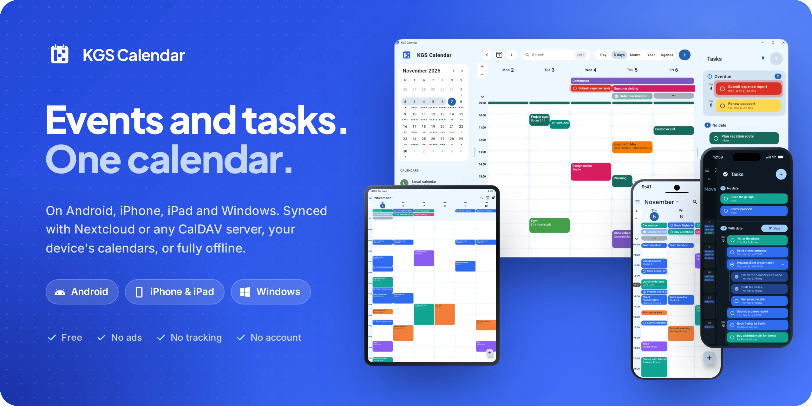
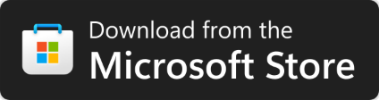
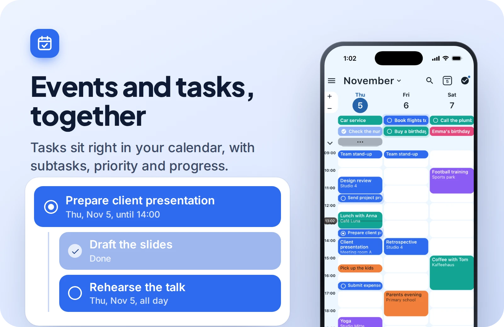
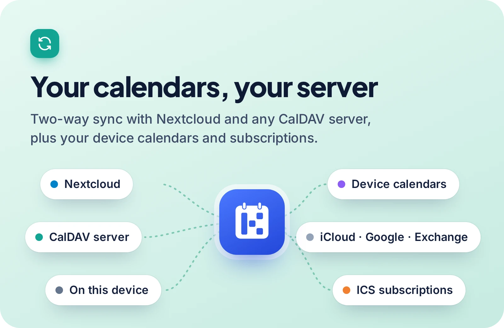
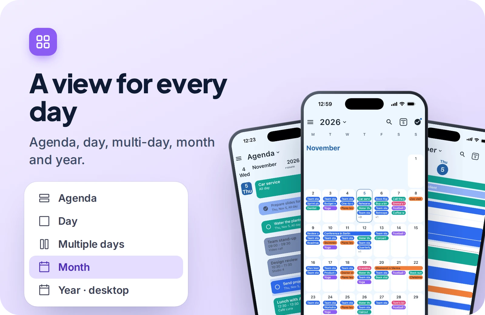
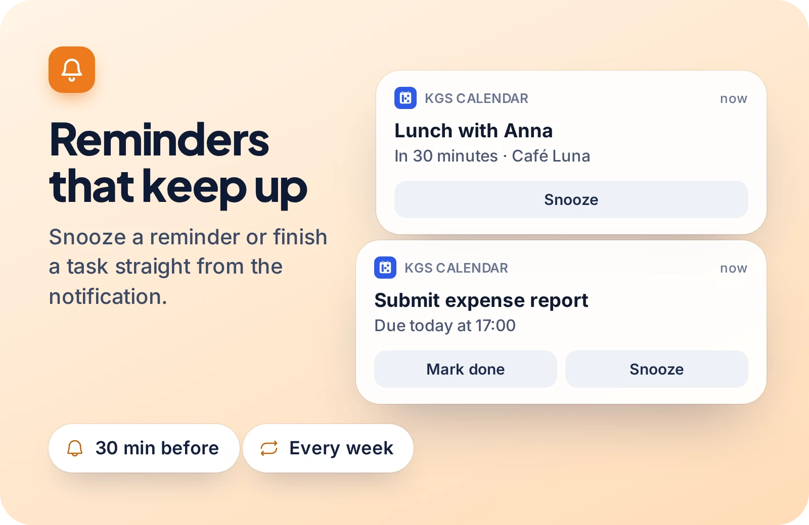
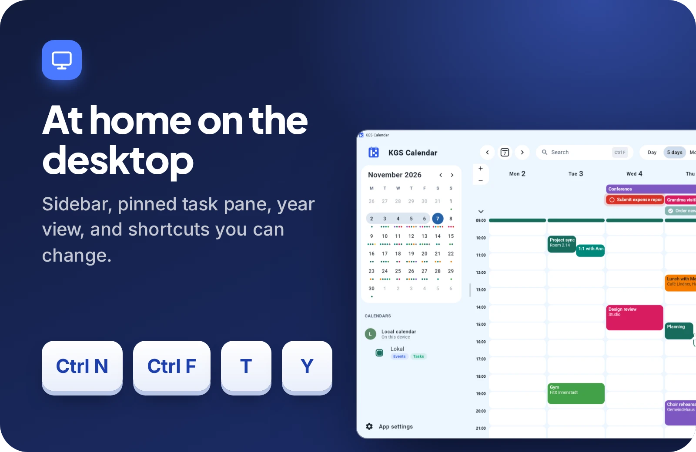
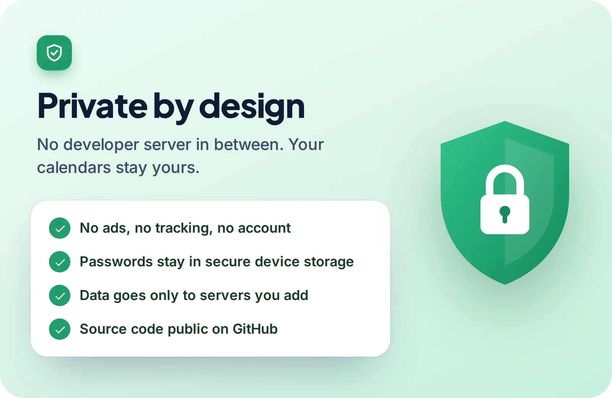
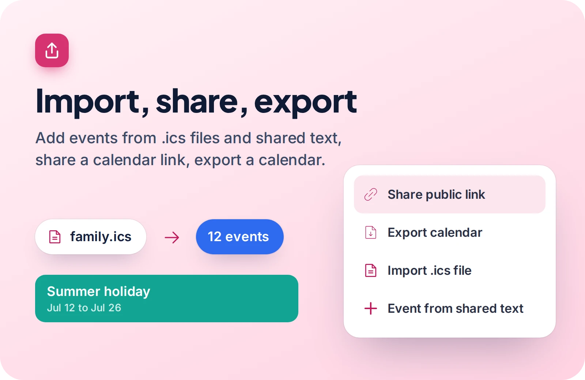
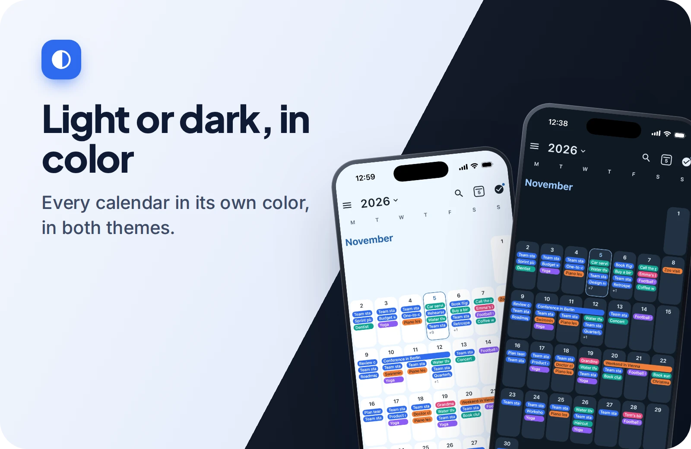

 

&nbsp;

<!-- Once the App Store release is live:

-->

**Events and tasks in one calendar.** Use it on its own, with the calendars already on your device,
or synced with Nextcloud and any CalDAV server. Free, with no ads, no tracking and no account.

## Features

  
  
  
  
  
  
  
  

<b>Everything it can do</b>

**Calendar**
- Agenda, day, multi-day, month views, and a year view on the desktop
- Drag events and tasks to another time or day
- Repeating events and tasks
- Search across events and tasks
- Colors, order and visibility for every calendar
- Light and dark theme, in English and German

**Tasks**
- Tasks next to your events, or in their own list
- Subtasks, priority, progress and categories
- An overdue section, so nothing slips

**Calendars and sync**
- Local calendars that need no server
- Your device's calendars: Android's calendars, and on iPhone and iPad the Calendar app's iCloud,
  Google and Exchange accounts
- Two-way sync of events and tasks with Nextcloud and other CalDAV servers
- Read-only ICS and CalDAV subscriptions
- Open `.ics` files from mail and file apps, check the events, and import them
- Share text from another app to start a new event
- Share a calendar's public link, or export a calendar

**Reminders**
- Reminders for events and tasks, with Snooze and, for tasks, Mark done

**Places**
- Optional location search and map previews from OpenStreetMap

**On each platform**
- Android: home screen widgets
- iPhone and iPad: passwords in the iOS Keychain, settings in two columns on iPad
- Windows: sidebar, pinned task pane, right-click menus, keyboard shortcuts you can change,
  reminders from the notification area, and start with Windows

## Get the app

| Platform | Where to get it |
| --- | --- |
| **Android** | [Google Play](https://play.google.com/store/apps/details?id=com.kgs501.kgscalendar), with automatic updates. APKs, including pre-releases, are on [GitHub Releases](https://github.com/KGS501/kgs-calendar/releases). |
| **Windows** | [Microsoft Store](https://apps.microsoft.com/detail/9P0NZM3HSQ92). The `.msi` installer is on [GitHub Releases](https://github.com/KGS501/kgs-calendar/releases). |
| **iPhone and iPad** | Coming soon to the App Store. |

## Privacy

KGS Calendar has no ads, no analytics and no server of its own. Your calendars go only to the servers
you add. Read the full [privacy policy](https://kgs501.github.io/kgs-calendar/).

## Support the project

Found a bug or missing something? [Open an issue](https://github.com/KGS501/kgs-calendar/issues).
If you like the app and want to support its development, consider sponsoring it.

## License

KGS Calendar is licensed under the [PolyForm Noncommercial License 1.0.0](LICENSE.md). It's
source-available, not open source: non-commercial use, changes and sharing are allowed under its
terms, and commercial use needs written permission from KGS501.
